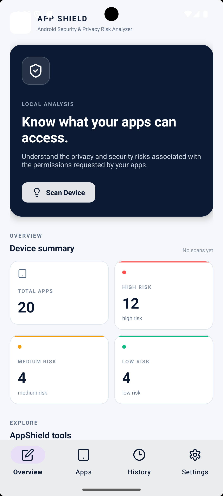
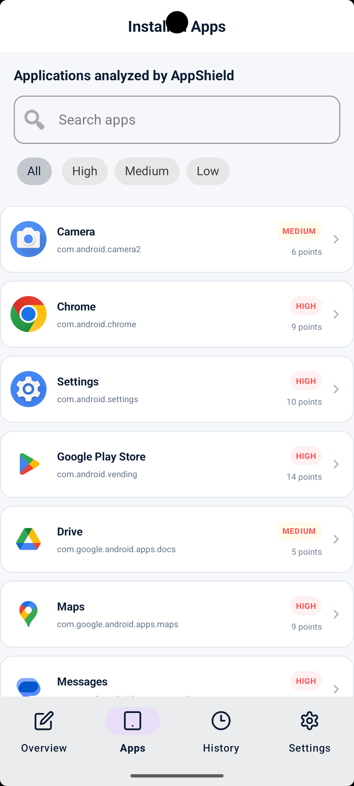
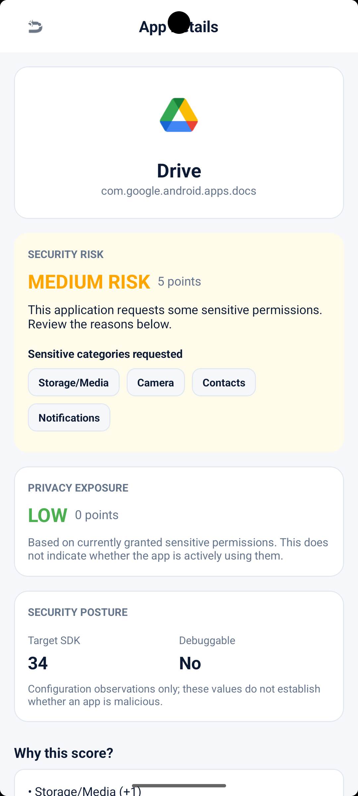
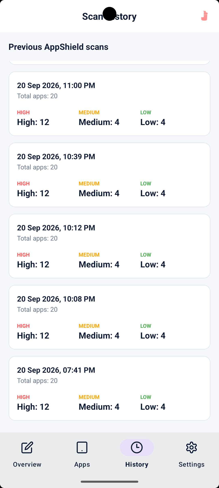
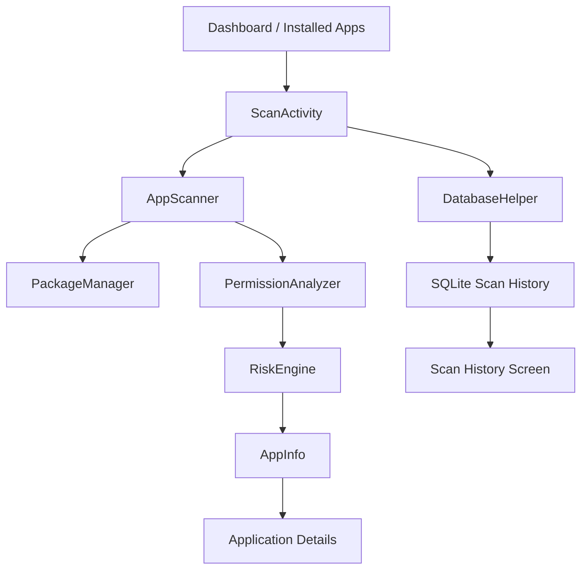

# AppShield

<p align="center">
  <strong>Android Security & Privacy Posture Analyzer</strong>
  <br/>
  Analyze permissions. Understand exposure. Make informed decisions.
</p>

<p align="center">
  
  
  
  
  
</p>

<p align="center">
  
</p>

AppShield is an Android application that analyzes the permission and selected security posture indicators of launchable applications. It uses a transparent, rule-based scoring model to summarize requested sensitive permissions, estimate privacy exposure from currently granted permissions, and retain local scan history.

**AppShield is an educational security analysis tool, not an antivirus or malware detector.**

---

## Table of Contents

- [Overview](#overview)
- [Features](#features)
- [Screenshots](#screenshots)
- [Technology Stack](#technology-stack)
- [Architecture](#architecture)
- [Risk Scoring Methodology](#risk-scoring-methodology)
- [Getting Started](#getting-started)
- [Testing](#testing)
- [Limitations](#limitations)
- [Future Improvements](#future-improvements)

## Overview

Android applications can request access to sensitive device capabilities and personal information. Understanding these permissions can help users make more informed decisions about the applications they install.

AppShield brings selected permission information and security posture indicators into one interface. It separates the permissions an application requests from the sensitive permissions currently granted to it, presenting two distinct heuristic scores.

### How it works

1. Discover launchable applications using Android's `PackageManager`.
2. Retrieve available package information and requested permissions.
3. Map recognized sensitive permissions to AppShield categories.
4. Calculate a security risk score from requested sensitive categories.
5. Calculate a separate privacy exposure score from currently granted sensitive categories.
6. Display target SDK and debuggable status.
7. Save scan summaries locally for future reference.

## Features

| Feature | Description |
|---|---|
| Application scanning | Discovers launchable applications on the device |
| Permission analysis | Groups selected sensitive permissions into understandable categories |
| Risk classification | Calculates a weighted score and classifies it as Low, Medium, or High |
| Privacy exposure estimate | Evaluates recognized sensitive categories among currently granted permissions |
| Security posture indicators | Displays target SDK version and debuggable status |
| Application details | Shows package information, risk reasons, and permission breakdowns |
| System settings navigation | Opens the selected application's Android settings |
| Scan history | Retains previous scan summaries in local storage |
| Dashboard | Summarizes scan results for the current app session |

## Screenshots

### Dashboard

<p align="center">
  
</p>

The dashboard provides an overview of scan results and access to the main application sections.

### Installed Applications

<p align="center">
  
</p>

Browse scanned applications and inspect their displayed risk classifications.

### Application Details

<p align="center">
  
</p>

Review the selected application's requested permissions, recognized sensitive categories, risk reasons, privacy exposure estimate, target SDK, and debuggable status.

### Scan History

<p align="center">
  
</p>

Review saved scan summaries and their recorded application and risk counts.

## Technology Stack

| Technology | Usage |
|---|---|
| Java | Application and analysis logic |
| XML | Android layouts and UI resources |
| Android SDK | Application framework and package inspection |
| `PackageManager` | Application discovery and permission inspection |
| SQLite | Local scan-history storage |
| Gradle Kotlin DSL | Build configuration |
| AndroidX | Activity and UI support libraries |
| Material Components | UI components and visual styling |
| Flexbox | Flexible category badge layouts |
| JUnit | Unit testing |
| Espresso | Instrumentation testing dependency |

## Architecture

AppShield separates application presentation, scanning, permission analysis, risk calculation, data models, and local persistence.



### Main Components

| Component | Responsibility |
|---|---|
| `AppScanner` | Discovers launchable apps and collects permission and configuration information |
| `PermissionAnalyzer` | Maps recognized Android permissions to AppShield's sensitive categories |
| `RiskEngine` | Calculates weighted scores, risk levels, and category-based explanations |
| `AppInfo` | Holds application information and analysis results |
| `DatabaseHelper` | Manages local scan-history persistence |
| `DashboardFragment` | Displays the current session's scan summary |
| `InstalledAppsFragment` | Displays scanned applications |
| `ScanHistoryFragment` | Displays saved scan records |
| `AppDetailsActivity` | Presents application details and analysis results |

## Risk Scoring Methodology

AppShield uses a **project-defined, category-based heuristic**. Each recognized category contributes its assigned weight once, even when multiple permissions map to that category.

### Category Weights

| Sensitive category | Points |
|---|---:|
| Camera | 1 |
| Storage/Media | 1 |
| Notifications | 1 |
| Location | 2 |
| Contacts | 2 |
| Microphone | 2 |
| SMS | 3 |
| Phone | 3 |

### Risk Levels

| Score | Classification |
|---|---|
| 0–3 | Low |
| 4–7 | Medium |
| 8 or more | High |

### Two Separate Indicators

**Security Risk**

Calculated from the sensitive categories recognized among the permissions an application requests.

**Privacy Exposure**

Calculated using the same category weights, but only for recognized sensitive permissions that are currently granted.

These scores answer different questions. An application can request sensitive permissions without currently having them granted, so its security risk score and privacy exposure score can differ.

### Interpretation

- The weights are selected by the AppShield project; they are not official Android security ratings.
- A permission request does not prove that the application uses the associated capability or accesses personal data.
- A granted permission does not prove that the application has accessed the corresponding data.
- Target SDK and debuggable status are displayed as separate posture indicators rather than being incorporated into these scores.
- A Low, Medium, or High classification is not proof that an application is safe or malicious.

## Getting Started

### Requirements

- Android Studio
- Android SDK
- A compatible Android emulator or physical device
- A Java and Gradle environment compatible with the project configuration

### 1. Clone the Repository

```bash
git clone https://github.com/shreyasharma-off/AppShield.git
cd AppShield
```

### 2. Open in Android Studio

Open the cloned `AppShield` directory in Android Studio and allow Gradle synchronization to finish.

### 3. Build the Application

On macOS or Linux:

```bash
./gradlew assembleDebug
```

On Windows:

```bat
gradlew.bat assembleDebug
```

### 4. Install the Debug APK

After a successful build, find the generated APK at:

```text
app/build/outputs/apk/debug/app-debug.apk
```

Install it on a compatible Android device or emulator for testing.

### Build Configuration

| Setting | Value |
|---|---|
| Application ID | `com.example.appshield` |
| Minimum SDK | 24 |
| Compile SDK | 35 |
| Target SDK | 35 |
| Version | 1.0 |
| Java compatibility | Java 11 |

## Testing

The repository contains unit-test classes for the permission analyzer and risk engine:

- `PermissionAnalyzerTest`
- `RiskEngineTest`

Run the local unit tests with:

```bash
./gradlew testDebugUnitTest
```

Build verification:

```bash
./gradlew clean assembleDebug
```

These commands can be used to verify the project locally. Test coverage and results should be reported only after the tests have actually been run.

## Limitations

- Scanning focuses on launchable applications and is not a complete inventory of every installed package.
- Available application information depends on Android package visibility and platform behavior.
- Permission status may vary by Android version and application configuration.
- The heuristic model covers selected permission categories rather than every Android permission.
- The application does not inspect runtime behavior, network traffic, or actual data access.
- It does not perform malware detection, vulnerability exploitation, or a comprehensive security audit.
- Risk classifications are estimates based on the project's chosen weights.

## Future Improvements

- Expand permission coverage and improve Android-version-aware interpretation.
- Add more automated tests for scoring boundaries and permission combinations.
- Improve explanations of security posture indicators.
- Improve accessibility and interface consistency.
- Explore additional static security checks with clear evidence and documented limitations.

---

<p align="center">
  <strong>AppShield</strong>
  <br/>
  Built to explore Android permissions, privacy exposure, and transparent security analysis.
</p>